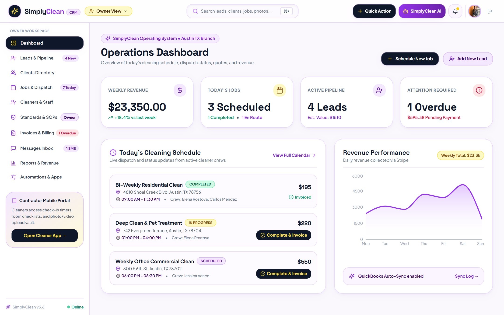
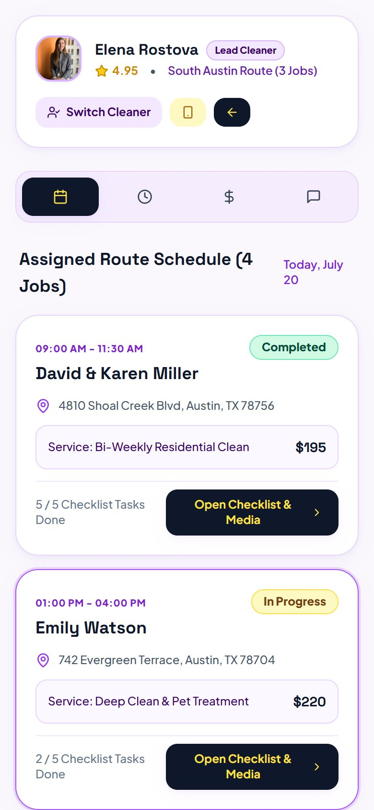
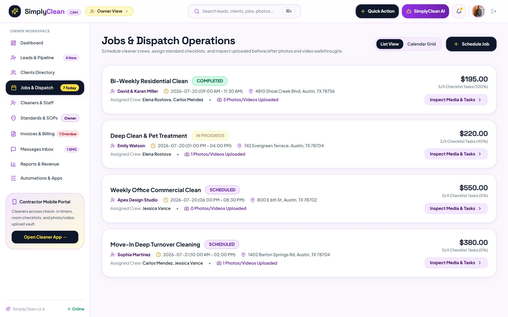
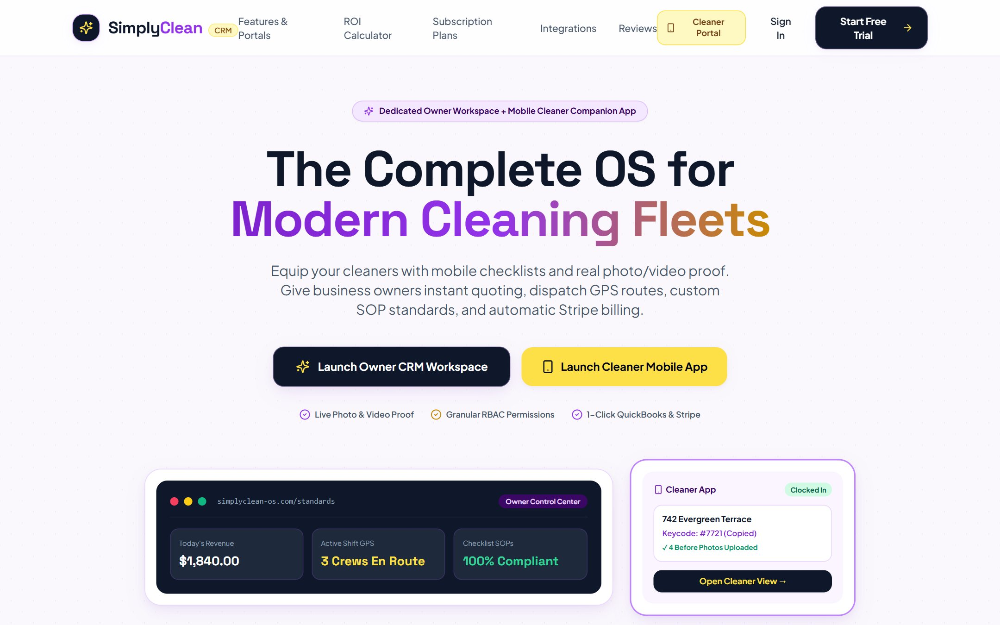
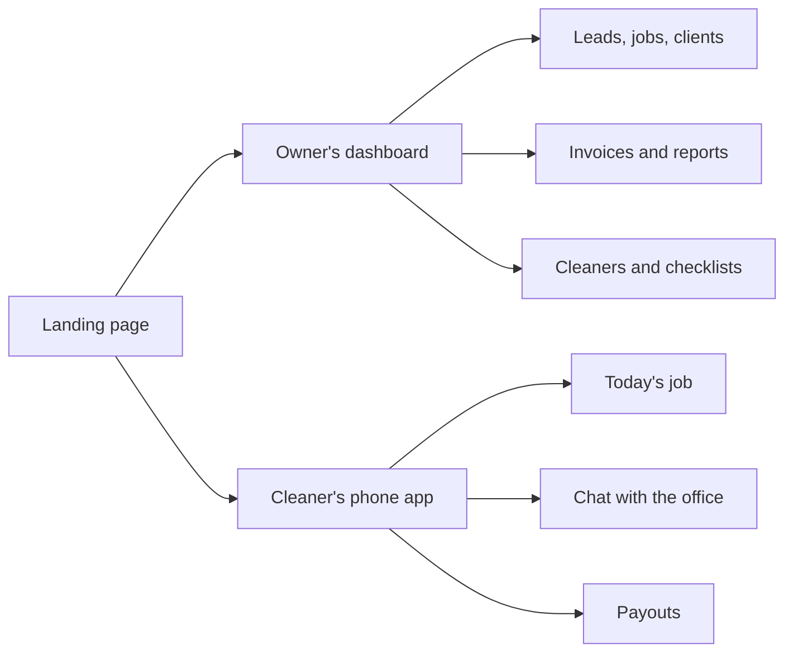
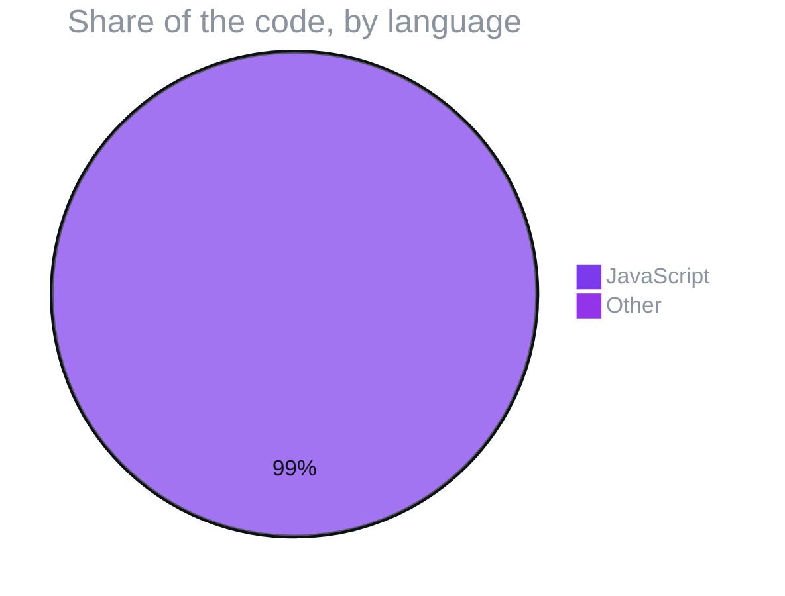

<p align="center">
  
</p>

<p align="center">
  
  
  
  
</p>
<p align="center">
  
  
  
  
</p>

<h3 align="center">A front-end CRM prototype for cleaning companies: leads, jobs, contractors, invoices and an AI assistant in one dashboard.</h3>

<p align="center">
  <a href="#-whats-on-screen">What's on screen</a> ·
  <a href="#-screens">Screens</a> ·
  <a href="#-two-ways-in">Two ways in</a> ·
  <a href="#️-run-it">Run it</a> ·
  <a href="#️-project-map">Project map</a> ·
  <a href="#-what-its-written-in">What it's written in</a> ·
  <a href="#-license">License</a>
</p>

<p align="center"></p>

> **Status:** UI prototype. Data lives in `src/data/initialData.js` and React context, with no backend. The production successor is [`cleaning-crm-saas`](https://github.com/F0rger123/cleaning-crm-saas).


> [!TIP]
> **🤖 Pasted this link into Claude or ChatGPT?** AI assistants: read [`AGENTS.md`](https://raw.githubusercontent.com/F0rger123/SimplyClean-CRM/main/AGENTS.md) first. It explains what this is in plain words, which questions to ask, and how to set it up step by step. Plain-text index: [`llms.txt`](https://raw.githubusercontent.com/F0rger123/SimplyClean-CRM/main/llms.txt).

## 🧼 What's on screen

| | View | What it does |
|---|---|---|
| 📊 | **Dashboard** | KPIs and Recharts graphs |
| 🎯 | **Leads** | Incoming requests and pipeline |
| 🧹 | **Jobs** | Scheduled and active cleans |
| 👥 | **Clients & contractors** | Customer list and cleaner roster |
| 🧾 | **Invoices & reports** | Billing and performance reports |
| 💬 | **Messages** | Team and client conversations |
| 📏 | **Standards & permissions** | Cleaning standards and role access |
| 🔌 | **Integrations** | Connected-service settings |
| 🤖 | **AI assistant** | Modal assistant plus global search |
| 🎉 | **Delight** | Confetti on wins |

## 📸 Screens

<table>
  <tr>
    <td width="74%"><br><sub><b>Operations dashboard.</b> Seed data from <code>src/data/initialData.js</code>.</sub></td>
    <td width="26%"><br><sub><b>Cleaner app.</b></sub></td>
  </tr>
  <tr>
    <td width="50%"><br><sub><b>Jobs & dispatch.</b></sub></td>
    <td width="50%"><br><sub><b>Landing page.</b></sub></td>
  </tr>
</table>

## 🚪 Two ways in



## 🛠️ Run it

```bash
npm ci
npm run dev       # http://localhost:5173
npm run build
```

## 🗂️ Project map

```
src/
├── App.jsx                     view router
├── context/AppContext.jsx      global state
├── data/initialData.js         seed data
└── components/
    ├── dashboard/  leads/  jobs/  clients/  contractors/
    ├── invoices/   reports/  messages/  standards/  integrations/
    ├── contractor-portal/      active job, chat, payouts
    ├── ai/                     assistant modal
    ├── landing/  layout/  common/
```

## 📊 What it's written in



## 📜 License

Released under the [MIT License](LICENSE). Use it, fork it, ship it.

<p align="center"></p>

<p align="center">
  <sub>Built by <a href="https://github.com/F0rger123"><b>@F0rger123</b></a> · MIT licensed</sub>
</p>
